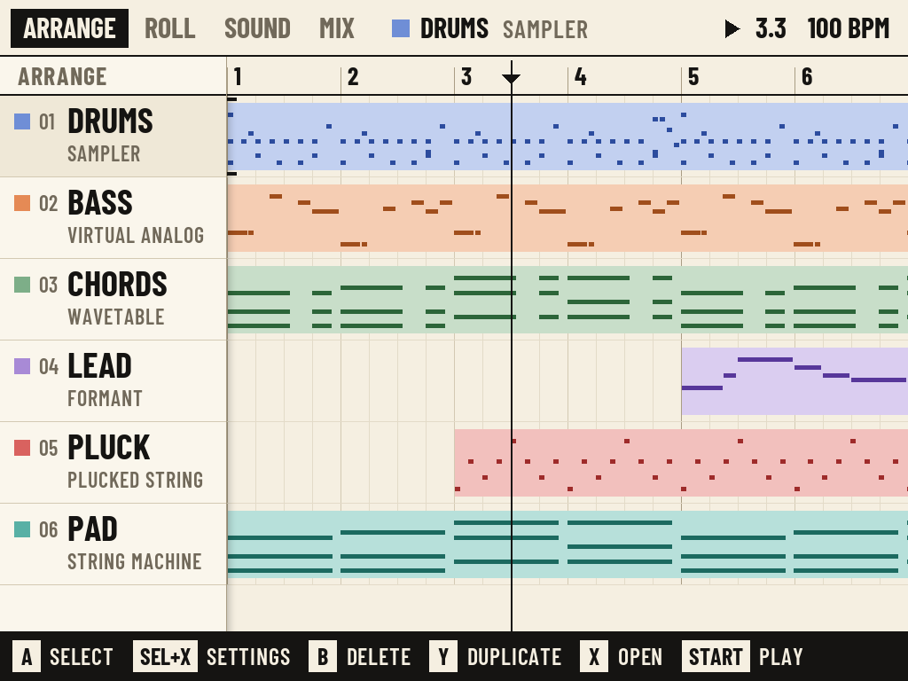
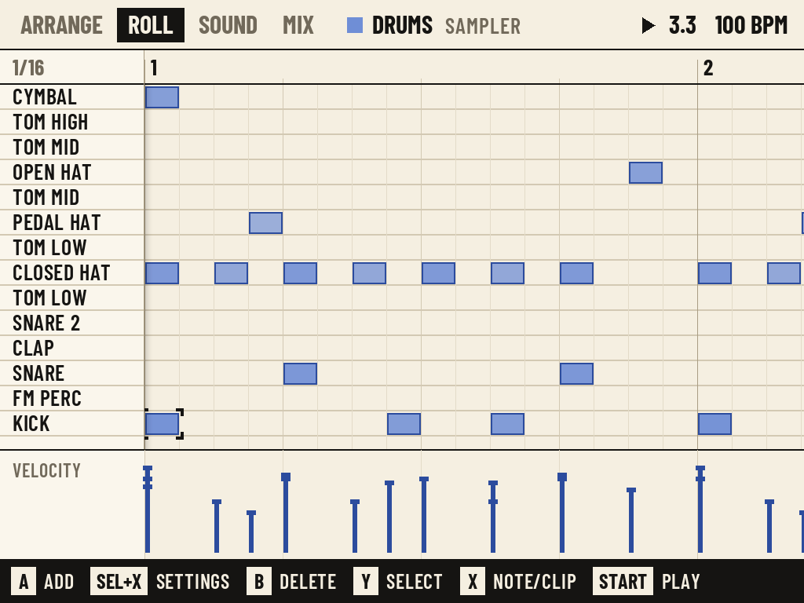

<h1>
  <picture>
    <source media="(prefers-color-scheme: dark)" srcset="Docs/images/wordmark-dark.svg">
    
  </picture>
</h1>

Twill is a portable groovebox with built-in synthesizer and sample instrument support. Songs are edited using a piano roll. It is being designed and coded on a TrimUI Brick Pro running KNULLI, but the goal is for it to work on any similar device via the PortMaster standard.

The design for this synth is in the [Docs/DESIGN.md](Docs/DESIGN.md) file.

  

  
  
  

The demo song on a 1024 x 768 screen (TrimUI Brick Pro).

Status: milestones M0 to M5 are done: arrangement, piano roll, sound, mixer; macro-oscillator and
sampler instruments with modulators, automation lanes and parameter locks; send effects; project
files; MIDI. See Docs/DESIGN.md §7 for the buttons (the hint bar shows them too). Menu + Start quits.

## Building

Needs CMake 3.20+ and Ninja.

**macOS** (SDL2 from Homebrew: `brew install sdl2`):

    cmake --preset macos && cmake --build --preset macos
    ./build/macos/twill

Keys: arrows move, X = A, Z = B, S = X, A = Y, Q / W = L / R, 1 / 2 = L2 / R2, Return/Space = Start, Tab = Select,
Escape = Menu (Escape + Return quits).

**KNULLI handhelds** (TrimUI Brick Pro), cross-compiled with Zig (`brew install zig`):

    tools/make-knulli-sysroot.sh root@<device>   # once: the device's SDL2 plus matching headers
    cmake --preset knulli && cmake --build --preset knulli
    tools/deploy-knulli.sh root@<device>         # copies it to the device's Ports folder

Then update the game lists in EmulationStation and start Twill Studio from Ports. Menu + Start
quits. The project autosaves to `autosave.twill` next to the app; saved projects go to `projects/`,
WAV renders to `renders/`, and the factory drum kit (built into the app from `assets/factory/`) to
`samples/Factory/`.

For PortMaster, `tools/make-portmaster-zip.sh` packages that build as `build/portmaster/twill.zip`
(drop it in PortMaster's autoinstall folder).

## Test hooks

- `TWILL_SCREENSHOT=frame.ppm` saves a frame after about a second and quits.
- `TWILL_VIEW=roll` starts in the piano roll.
- `TWILL_UI_SCALE=1.5` overrides the UI scale; `TWILL_FULLSCREEN=1` uses the handheld layout on desktop.
- `SDL_VIDEODRIVER=dummy SDL_AUDIODRIVER=dummy` runs without a display or sound device.

## Tests

    ./build/macos/twill_tests                 # or: ctest --test-dir build/macos
    ./build/macos/twill_tests --update-golden # after an intended change to the sound

On a device: copy `build/knulli/twill_tests` and `tests/golden/` over and run it with
`--golden-dir <dir>`.

## Tools

- `twill_bench`: drawing benchmark, no display needed.
- `twill_macro_lab render <dir>`: renders each of the 24 macro-oscillator engines to a WAV.
- `twill_macro_lab bench [frames]`: cost per voice for each engine, as a share of one core.

Both run over SSH on a handheld: copy them from `build/knulli/` to the device's `/tmp`.

## Releases

GitHub Actions (`.github/workflows/build.yml`) builds the handheld version and runs the tests on
GitHub's AArch64 Linux machines for every push to `main`. A version tag publishes a release:

1. Set the version in `CMakeLists.txt` (`project(TwillStudio VERSION x.y.z)`) and push it.
2. Tag that commit with the release notes as the tag's message, and push the tag:
   `git tag -a vx.y.z -m "notes"` then `git push origin vx.y.z`.
3. The workflow checks the tag matches the version, builds, tests, and publishes "Twill Studio x.y.z"
   with `twill.zip` (the PortMaster package) attached.

## License

Twill Studio is free software: you can redistribute it and/or modify it under the terms of the GNU
General Public License, version 3 or (at your option) any later version, in `LICENSE`. It comes with
no warranty.

The factory kit's samples (`assets/factory/`) are dedicated to the public domain under CC0 1.0: use
them in anything, with or without credit. Music you make with Twill Studio is yours.

## Third-party code

- Macro-oscillator DSP and Clouds' reverb from Emilie Gillet's eurorack code (MIT):
  `third_party/eurorack/`, see its README for the source commits and the naming rule for derivative
  works.
- `dr_wav` 0.14.6 (public domain or MIT-0): `third_party/dr_libs/`.
- Jacquard 24 and Jersey 15 fonts (SIL Open Font License 1.1), for the wordmark only:
  `third_party/fonts/jacquard24/`, `third_party/fonts/jersey15/`; `tools/make-wordmark.py` draws it.
- Inter and Barlow Condensed fonts (SIL Open Font License 1.1): `third_party/fonts/inter/`,
  `third_party/fonts/barlow-condensed/`. `tools/mkfonts.py` turns them into `src/gfx/gen/fonts.cpp`.
