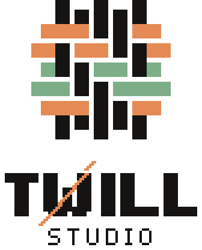
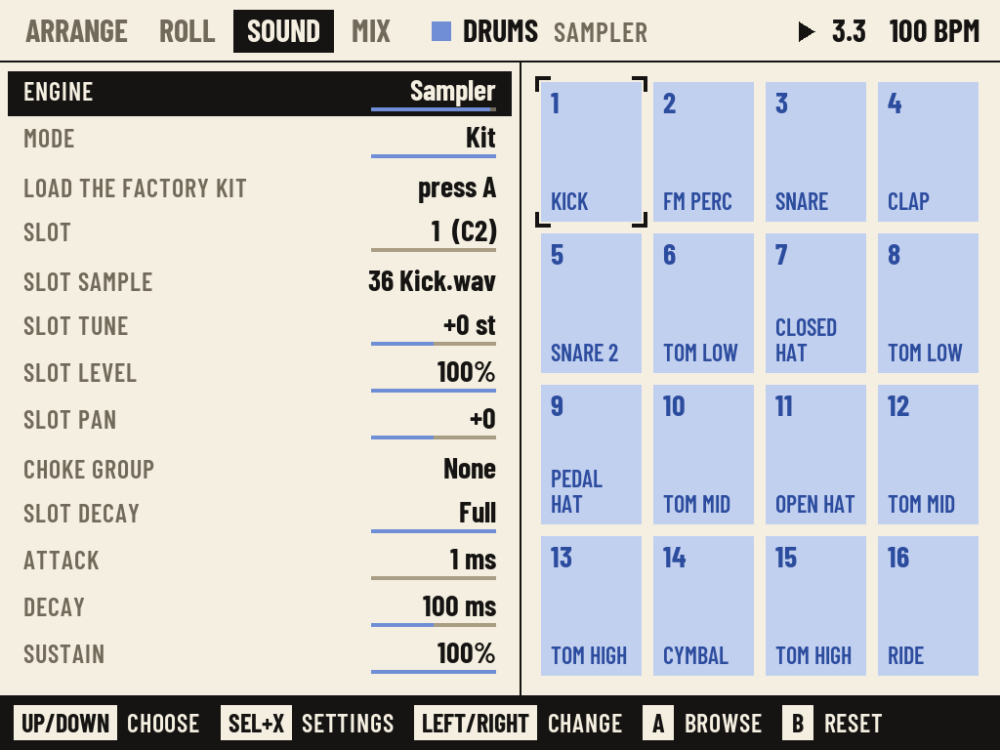
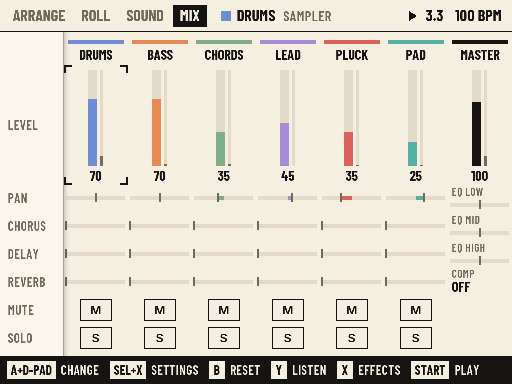

  <picture>
    <source media="(prefers-color-scheme: dark)" srcset="Docs/images/logo/twill-logo-dark-transparent-4x.png">
    
  </picture>

Twill is a portable groovebox with built-in synthesizer and sample instrument support. Songs are edited using a piano roll. It is being designed and coded on a TrimUI Brick Pro running KNULLI, but the goal is for it to work on any similar device via the PortMaster standard.

**[Play it in your browser](https://liminalkid.github.io/TwillStudio/play/)**, or see
[the website](https://liminalkid.github.io/TwillStudio/). It's also on
[itch.io](https://liminalkid.itch.io/twill-studio).

The design for this synth is in the [Docs/DESIGN.md](Docs/DESIGN.md) file.

  

  
  
  

The demo song on a 1024 x 768 screen (TrimUI Brick Pro).

See Docs/DESIGN.md §7 for the buttons (the hint bar shows them too). Menu + Start quits. To build
it yourself, see [BUILDING.md](BUILDING.md).

The logo, for dark and light backgrounds, is in [Docs/images/logo/](Docs/images/logo/).

## License

Twill Studio is free software: you can redistribute it and/or modify it under the terms of the GNU
General Public License, version 3 or (at your option) any later version, in `LICENSE`. It comes with
no warranty.

The factory kit's samples (`assets/factory/`) are dedicated to the public domain under CC0 1.0: use
them in anything, with or without credit. Music you make with Twill Studio is yours.

## Third-party code

- Macro-oscillator DSP and Clouds' reverb from Emilie Gillet's eurorack code (MIT):
  `third_party/eurorack/`, see its README for the source commits and the naming rule for derivative
  works.
- `dr_wav` 0.14.6 (public domain or MIT-0): `third_party/dr_libs/`.
- Inter and Barlow Condensed fonts (SIL Open Font License 1.1): `third_party/fonts/inter/`,
  `third_party/fonts/barlow-condensed/`. `tools/mkfonts.py` turns them into `src/gfx/gen/fonts.cpp`.
